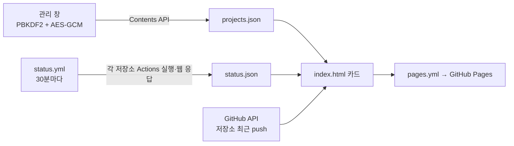

# 개인 프로젝트 모음

GitHub 저장소 목록 대신, 각 프로젝트의 **웹**과 **Git**을 한 페이지에서 엽니다.

**뷰어:** https://hyungmo1234.github.io/

이 저장소(`Hyungmo1234.github.io`)가 계정 GitHub Pages 홈입니다. GitHub 프로필 첫 화면은 [`Hyungmo1234/Hyungmo1234`](https://github.com/Hyungmo1234/Hyungmo1234) README입니다.

로컬에서는 `index.html`을 브라우저로 열거나, 이 폴더에서 정적 서버를 켜면 됩니다.

```powershell
python -m http.server 5500
```

그리고 http://127.0.0.1:5500 을 엽니다.

## 프로젝트

| 프로젝트 | 무엇을 풀었나 | 기술 | 웹 | GitHub |
|---|---|---|---|---|
| Prophecy | 공공 원천 데이터로 아파트 현재 가치·3/6/12개월 전망. 서울·경기 실거래 362만 건, 12개월 예측 MAE 기준선 대비 −38% | Python ETL · PostgreSQL · XGBoost/LightGBM · Spring Boot · React | [웹 열기](https://hyungmo1234.github.io/prophecy-link/) | 비공개 |
| 데일리하우스 | 매일 아침 부동산 뉴스 수집 → 중복·무관 기사 제거 → LLM 요약 → 자동 발행. 28회 연속 발행 | Python · OpenAI · Jinja2 · Pillow · GitHub Actions | [뉴스 페이지](https://hyungmo1234.github.io/daily-house/) | [daily-house](https://github.com/Hyungmo1234/daily-house) |
| 매일하루영단어 | 하루 한 장 카드 PWA + 유튜브 숏츠 자동 발행 | FastAPI · Vite PWA · Fly.io · YouTube API | [앱](https://daily-english-hyungmo.fly.dev) · [YouTube](https://www.youtube.com/channel/UCIBCHpm-Y71wkQBVet9wXzw) | 비공개 |
| 매일하루영단어 (일본인) | 같은 파이프라인을 일본어 사용자용으로 분기 | FastAPI · PWA · YouTube API | [앱](https://daily-english-hyungmo.fly.dev/#ja) · [YouTube](https://www.youtube.com/channel/UCVguZaN1HSqr8uhzFE4momQ) | 비공개 |
| 매일하루일본어 | 후리가나 카드 + 하루 6슬롯 숏츠 업로드 | FastAPI · Vite PWA · Fly.io · YouTube API | [앱](https://daily-nihongo-hyungmo.fly.dev) · [YouTube](https://www.youtube.com/channel/UC8TVY1GZN0MPReRj0iiXjIg) | 비공개 |
| 강의 녹음 툴 | 수업 녹음을 Whisper로 받아쓰고 강의 노트 정리 | Python · Whisper · Cursor | 로컬 PC | (아직 Git 없음) |
| 강의 단어 | 모르는 단어를 강의 맥락으로 묻고 날짜별 노트로 저장 | Python · Vanilla JS · Cursor API | 로컬 PC | [lecture-words](lecture-words/) |
| 형모 Cursor Desk | Cursor SDK 데스크톱 채팅 앱 | Cursor SDK | 로컬 PC | (아직 Git 없음) |
| VS Workspace Theme | 커뮤니티 페이지를 VS Code처럼 보이게 하는 확장 | Chrome Extension | 크롬 확장 | (아직 Git 없음) |
| 파이썬 공부 | 날짜별 연습 + 일일 노트 자동 push | Python · NumPy · pandas · Jupyter | | [261015python](https://github.com/Hyungmo1234/261015python) |
| AICE 모의고사 | 학생성적 예측 문제 풀이 | pandas · scikit-learn | | 비공개 |
| 모바일 청첩장 | 결혼식용 모바일 청첩장 | Next.js 14 · TypeScript · Tailwind · Vercel | [Vercel](https://mobile-invitation-by-cursor.vercel.app) | [mobile_invitationByCursor](https://github.com/Hyungmo1234/mobile_invitationByCursor) |

카드를 더하거나 고치려면 [`projects.json`](projects.json)만 수정하면 됩니다. 카드마다 `blurb`(문제 → 접근 → 결과), `highlights`(확인된 숫자), `stack`(기술)을 적고, 맨 위 `weekly`에 이번 주 작업을 적습니다.

## 이 사이트는 어떻게 돌아가나



- `status.yml`: 30분마다 `scripts/collect_status.py`가 자동 발행 작업(영단어·일본어·데일리하우스)의 마지막 실행과 웹 응답을 모아 `status.json`을 커밋합니다. 이 파일은 손으로 고치지 않습니다.
- `pages.yml`: `main`에 push되면 정적 파일만 골라 GitHub Pages로 배포합니다.
- 관리 창: 비밀번호로 암호화된 토큰을 풀어 카드 문구를 바로 고치거나, 고칠 내용을 `inbox/`에 남깁니다.
